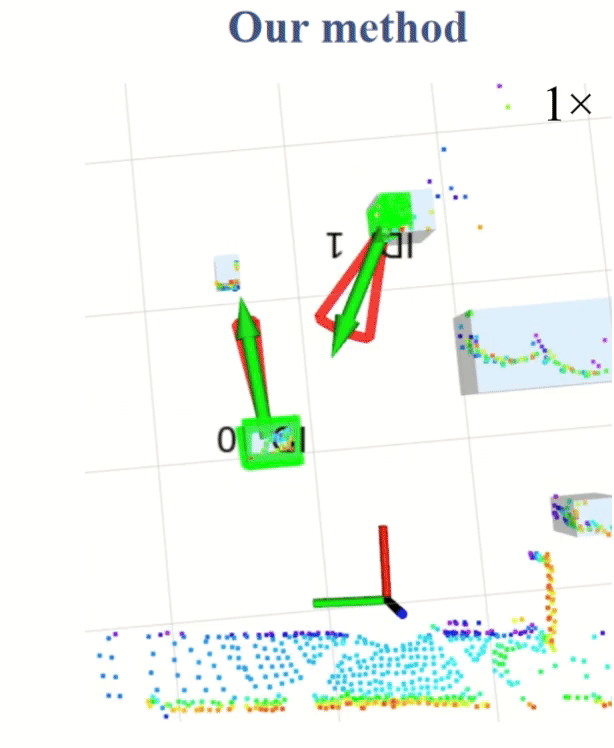
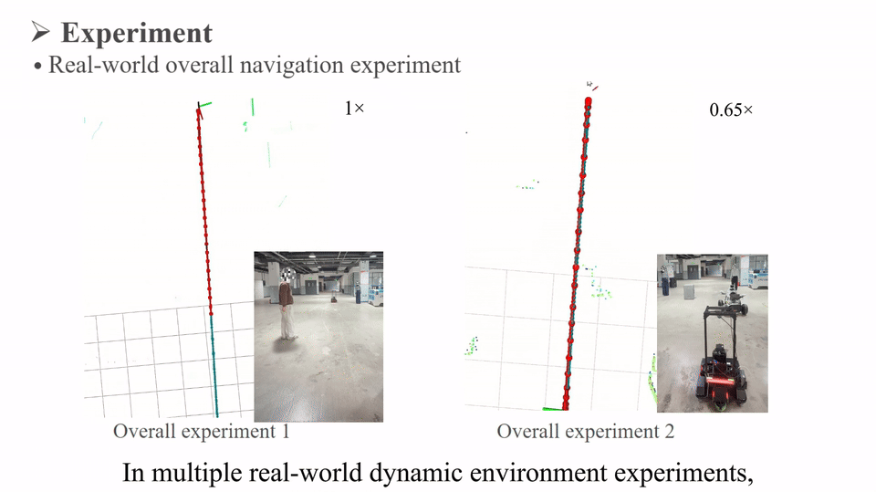
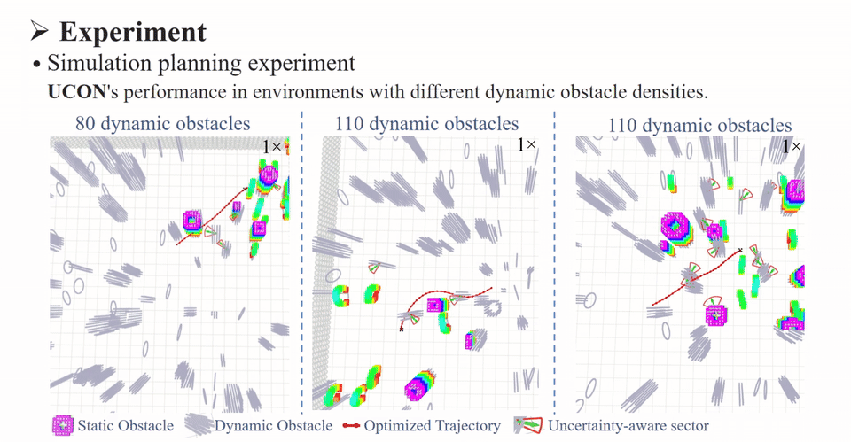

# UCON

Uncertainty-aware navigation with historical re-association and trajectory optimization in dynamic environments.

UCON combines dynamic obstacle tracking, motion uncertainty estimation, and trajectory planning in a ROS 1 workspace.

## Paper

[UCON: Uncertainty-aware Navigation with Historical Re-association in Dynamic Environments](https://arxiv.org/abs/2609.29419)

Bing Sun, Yue Lin, Yongsheng Yuan, Yang Liu, Dong Wang, and Huchuan Lu.

Accepted to IROS 2026.

## Experiments

### Real-world perception



Real-world perception with UCON, demonstrating obstacle tracking and historical re-association.

### Real-world navigation



Overall navigation experiments in real-world dynamic environments.

### Simulation



Simulation planning under different dynamic obstacle densities. The animation shows static and dynamic obstacles, optimized trajectories, and uncertainty sectors.

## Repository structure

- `src/perception`: point-cloud perception and dynamic obstacle tracking.
- `src/obj_state_msgs`: obstacle state messages.
- `src/planner`: mapping, path search, trajectory optimization, and planner management.
- `UCON_start.yaml`: tmuxp configuration for the perception and planning pipeline.

## Build and run

Prepare a ROS 1 catkin environment with the dependencies declared in the packages, including Eigen, PCL, and OpenCV. Install `tmux` and `tmuxp` to use the provided session configuration.

```bash
git clone https://github.com/Bling-sun/UCON.git
cd UCON
# Source your ROS 1 environment before building.
catkin_make --only-pkg-with-deps obj_state_msgs
catkin_make -DCATKIN_WHITELIST_PACKAGES=""
source devel/setup.bash
tmuxp load UCON_start.yaml
```

The launch configuration expects platform sensor and odometry inputs. Check the topics, transforms, and parameters in `src/perception/launch/perception.launch` and `src/planner/plan_manage/launch/realworld.launch` for your robot before running.

Stop the session with:

```bash
tmux kill-session -t UCON
```

## Citation

```bibtex
@article{sun2026ucon,
  title={UCON: Uncertainty-aware Navigation with Historical Re-association in Dynamic Environments},
  author={Sun, Bing and Lin, Yue and Yuan, Yongsheng and Liu, Yang and Wang, Dong and Lu, Huchuan},
  journal={arXiv preprint arXiv:2609.29419},
  year={2026},
  url={https://arxiv.org/abs/2609.29419}
}
```
