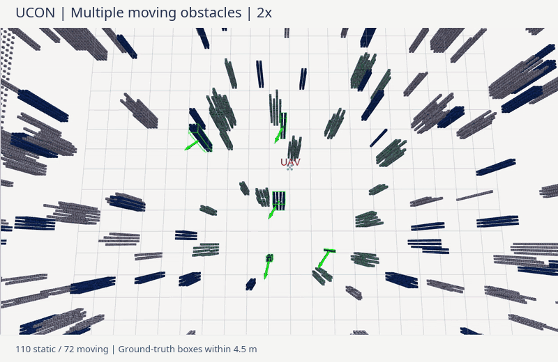

# UCON — ROS 2 Jazzy

[](https://github.com/Bling-sun/UCON/actions/workflows/ros2.yml)

基于 ROS 2 的无人机动态避障仿真。

## 运行演示



**2 倍速** · 60 个静态 / 72 个动态障碍物 · 连续到达 4 个目标。
采用无人机 **4.5 米内的动态障碍物真值**，展示规划避让效果。

## 快速开始

环境：Ubuntu 24.04 + [ROS 2 Jazzy](https://docs.ros.org/en/jazzy/Installation/Ubuntu-Install-Debs.html)。

```bash
git clone https://github.com/Bling-sun/UCON.git
cd UCON
./scripts/install_dependencies.sh
./build.sh
./run_simulation.sh
```

在 RViz 中用 **2D Goal Pose** 设置目标，`Ctrl+C` 停止。
默认场景为 60 个静态、36 个动态障碍物；演示密度可用 `dynamic_obstacles:=72` 启动。

```bash
./scripts/test.sh  # 运行测试
```

## 文档

[参数与录制](docs/USAGE.md) · [数据流](ROS2.md) · [验证记录](docs/VALIDATION.md)

## 论文与参考

[UCON 论文](https://arxiv.org/abs/2609.29419) · [BibTeX](CITATION.bib)。
感知与规划代码参考 [FAPP](https://github.com/arclab-hku/FAPP)。
